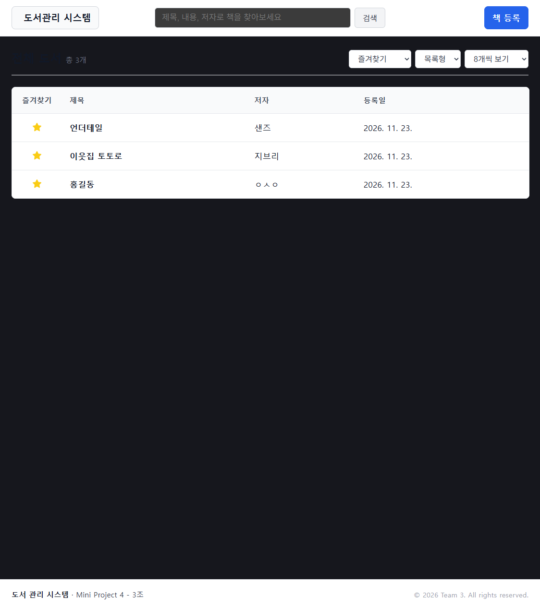
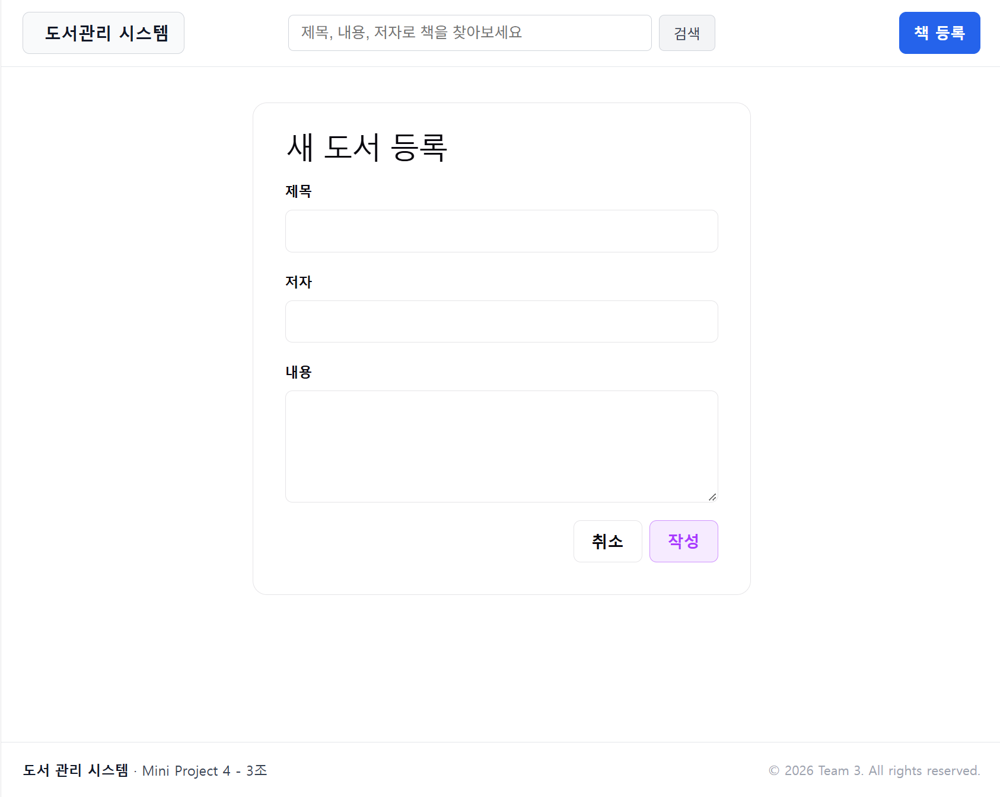
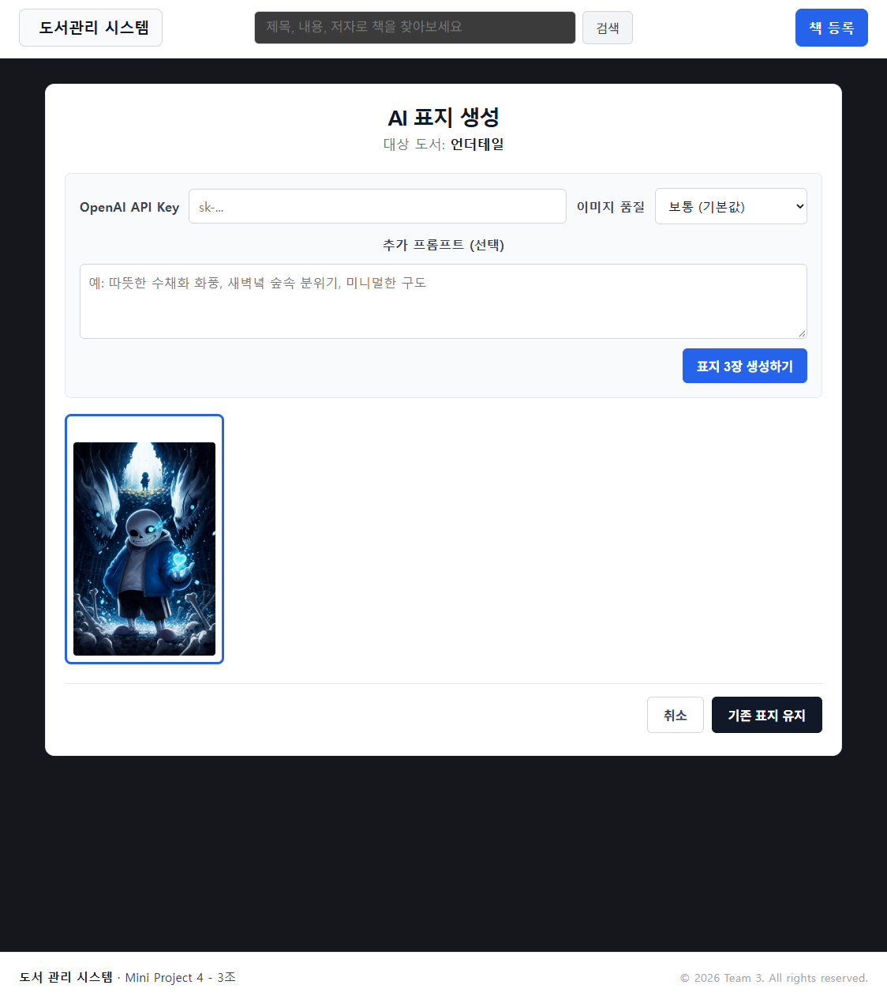

# 📚 도서관리 시스템 (mini_proj_4)

도서를 등록·조회·수정·삭제하고, AI로 도서 표지를 생성할 수 있는 웹 애플리케이션입니다.
React(Vite)로 화면을 만들고, json-server를 가짜 REST API 서버로 사용합니다.

- 프로젝트 문서(요구사항, API, 회의록): [Notion 도서관리](https://experienced-bergamot-d5d.notion.site/41ed06ed7e2c810591c8c7557187d81c?source=copy_link)

---

### 실행
`library-manager` 폴더에서 터미널 두 개를 열어 각각 실행합니다.

```powershell
npx.cmd json-server --watch db.json --port 3000
```

```powershell
npm.cmd run dev
```

## 기능 및 API

- **Base URL**: `http://localhost:3000` (json-server)
- **데이터 형식**: JSON (`Content-Type: application/json`)
- **날짜 형식**: ISO 8601 (`2026-11-20T09:00:00.000Z`)
- 유효성 검사(공백·글자 수·중복)는 **화면에서** 처리합니다. json-server는 요청 내용을 검사하지 않습니다.

### 기능 요약

| # | 기능 | 메서드 | URL | 화면 |
|---|---|---|---|---|
| 1 | 도서 목록 조회 | GET | `/books?_page&_limit&_sort&_order` | `/` |
| 2 | 도서 검색 | GET | `/books?title_like` · `content_like` · `author_like` | `/?q=검색어` |
| 3 | 도서 상세 조회 | GET | `/books/:id` | `/books/:id` |
| 4 | 도서 등록 | GET → POST | `/books?title&content` → `/books` | `/books/new` |
| 5 | 도서 수정 | GET → PATCH | `/books/:id` → `/books/:id` | `/books/:id/edit` |
| 6 | 도서 삭제 | DELETE | `/books/:id` | `/books/:id` |
| 7 | AI 표지 후보 생성 | POST | `https://api.openai.com/v1/images/generations` | `/books/cover` |
| 8 | 표지 선택·저장 | PATCH | `/books/:id` | `/books/cover` |
| 9 | 즐겨찾기 | - | (localStorage, API 없음) | 목록·상세 |

---

### 1. 도서 목록 조회

등록된 도서를 페이지 단위로 정렬해서 보여줍니다.

| 항목 | 내용 |
|---|---|
| 메서드 / URL | `GET /books` |
| 화면 기능 | 카드형(표지·제목·저자) / 목록형(제목·저자·등록일) 보기 전환, 페이지당 8·12·16·20개, 페이지네이션(이전·번호·다음) |
| 성공 | `200` · 도서 **배열** 응답, 전체 개수는 응답 헤더 `X-Total-Count` |
| 실패 | "에러: 책 요청 실패: {상태코드}" 표시 |
| 결과 0건 | "검색 도서 없음" 표시 |

**Query Parameter**

| 이름 | 예시 | 설명 |
|---|---|---|
| `_page` | `1` | 페이지 번호 |
| `_limit` | `8` | 페이지당 개수 (8 / 12 / 16 / 20) |
| `_sort` | `createdAt` | 정렬 필드: `createdAt`(최신 등록순), `updatedAt`(최근 수정순), `title`(제목순) |
| `_order` | `desc` | 정렬 방향: 등록순·수정순 `desc`, 제목순 `asc` |

```txt
GET /books?_page=1&_limit=8&_sort=createdAt&_order=desc
```

```json
[
  { "id": "1", "title": "별빛 아래의 서점", "author": "홍길동", "content": "...", "coverImageUrl": "...", "createdAt": "...", "updatedAt": "..." }
]
```

- 정렬·개수를 바꾸면 1페이지로 이동합니다.
- 보기 형식(카드형/목록형)은 브라우저 `localStorage`의 `viewMode` 키에 저장되어 검색·페이지 이동·새로고침 후에도 유지됩니다.
- **즐겨찾기** 정렬은 `GET /books?_sort=createdAt&_order=desc`로 전체를 받은 뒤, 화면에서 즐겨찾기한 도서만 걸러 페이지를 나눕니다.

---

### 2. 도서 검색

제목·내용·저자에 키워드가 포함된 도서를 찾습니다.

| 항목 | 내용 |
|---|---|
| 메서드 / URL | `GET /books?{필드}_like={키워드}` × 3 (동시 요청) |
| 화면 기능 | 헤더 검색창에서 검색 버튼 또는 Enter, 검색어는 URL `/?q=검색어`로 유지(새로고침·뒤로가기 대응) |
| 입력 조건 | 앞뒤 공백 제거 후 **2글자 이상**, 미만이면 입력창에 안내 말풍선 표시 / 빈 검색어는 전체 목록 |
| 성공 | 세 요청 결과를 합쳐 **id 기준 중복 제거** → 선택한 정렬 적용 → 화면에서 페이지 나누기 |
| 실패 | 하나라도 실패하면 "검색 요청 실패" 표시 |

```txt
GET /books?title_like=하늘
GET /books?content_like=하늘
GET /books?author_like=하늘
```

- `_like`는 json-server에서 **정규식**으로 처리되므로, `(`, `+` 같은 특수문자는 이스케이프 후 전송합니다.
- 대소문자를 구분하지 않습니다.
- 새로 검색하면 1페이지부터 표시합니다. 같은 검색 결과 안에서 페이지·정렬을 바꿀 때는 서버에 다시 요청하지 않습니다.

---

### 3. 도서 상세 조회

| 항목 | 내용 |
|---|---|
| 메서드 / URL | `GET /books/:id` |
| 화면 기능 | 표지, 제목, 저자, 등록일, 수정일, 본문, 즐겨찾기 ★, [AI 표지 생성] · [도서 수정] · [도서 삭제] 버튼 |
| 성공 | `200` · 도서 객체 |
| 404 | "도서를 찾을 수 없어요 — 삭제되었거나 존재하지 않는 도서입니다." |
| 기타 실패 | "도서를 불러오지 못했어요" + [다시 시도] 버튼 |

- 표지가 없거나 이미지 로딩에 실패하면 기본 표지를 표시합니다.
- 다른 도서로 이동하거나 화면을 벗어나면 이전 요청을 취소해, 오래된 응답이 반영되지 않습니다.

---

### 4. 도서 등록

| 항목 | 내용 |
|---|---|
| 메서드 / URL | ① `GET /books?title={제목}&content={내용}` (중복 확인) → ② `POST /books` |
| 화면 기능 | 제목·저자·내용 입력 폼, 성공 시 목록으로 이동 |
| 입력 조건 | 세 항목 모두 공백 불가, 제목 100자 · 저자 50자 이내 |
| 중복 | 제목과 내용이 같은 도서가 있으면 "이미 등록된 도서입니다." |
| 실패 | "도서를 등록하지 못했습니다. 서버 연결을 확인해 주세요." |

**Request Body** (`POST /books`)

| 이름 | 타입 | 필수 | 설명 |
|---|---|---|---|
| title | string | O | 제목 (앞뒤 공백 제거) |
| author | string | O | 저자 |
| content | string | O | 내용 |
| createdAt | string | O | 등록 시각 (화면에서 생성) |
| updatedAt | string | O | 등록 시각과 동일 |

```json
{
  "title": "별빛 아래의 서점",
  "author": "홍길동",
  "content": "작은 서점에서 시작되는 이야기",
  "createdAt": "2026-11-23T05:01:13.629Z",
  "updatedAt": "2026-11-23T05:01:13.629Z"
}
```

- 응답: `201` · `id`가 붙은 도서 객체. 새 도서의 `id`는 json-server가 `"pBcQ-Q5"` 같은 랜덤 문자열로 생성합니다.
- 표지는 등록 후 상세 페이지의 [AI 표지 생성]에서 추가합니다.

---

### 5. 도서 수정

| 항목 | 내용 |
|---|---|
| 메서드 / URL | ① `GET /books/:id` (기존 정보 불러오기) → ② `GET /books?title&content` (중복 확인) → ③ `PATCH /books/:id` |
| 화면 기능 | 기존 제목·저자·내용이 채워진 폼, 성공 시 상세 페이지로 이동 |
| 입력 조건 | 등록과 동일 (공백 불가, 글자 수 제한) |
| 변경 없음 | 저장하지 않고 "변경된 내용이 없습니다." |
| 중복 | 자기 자신을 제외하고 같은 제목·내용이 있으면 "이미 등록된 도서입니다." |
| 실패 | "도서를 수정하지 못했습니다. 서버 연결을 확인해 주세요." |

**Request Body** (`PATCH /books/:id`)

```json
{
  "title": "별빛 아래의 서점 (개정판)",
  "author": "홍길동",
  "content": "수정된 내용",
  "updatedAt": "2026-11-23T06:00:00.000Z"
}
```

- `PATCH`라서 보낸 필드만 바뀌고, `coverImageUrl`·`createdAt`은 유지됩니다.

---

### 6. 도서 삭제

| 항목 | 내용 |
|---|---|
| 메서드 / URL | `DELETE /books/:id` |
| 화면 기능 | 상세 페이지 [도서 삭제] → 확인 창 → 삭제 후 목록으로 이동, 상단에 "도서가 삭제되었습니다." 알림 |
| 404 | 이미 삭제된 것으로 처리하고 "이미 삭제된 도서입니다." 알림 |
| 실패 | 확인 창을 유지하고 "삭제하지 못했습니다. 잠시 후 다시 시도해 주세요." |

- 확인 창에서 취소하면 요청하지 않습니다.
- 삭제 중에는 버튼을 비활성화해 중복 요청을 막습니다.

---

### 7. AI 표지 후보 생성

도서 제목과 내용을 바탕으로 표지 후보 3장을 생성합니다.

| 항목 | 내용 |
|---|---|
| 메서드 / URL | `POST https://api.openai.com/v1/images/generations` |
| 인증 | `Authorization: Bearer {API Key}` — 화면에서 사용자가 직접 입력 (저장하지 않음) |
| 화면 기능 | API Key 입력, 품질 선택, 추가 프롬프트(선택), [표지 3장 생성하기] (다시 누르면 새 후보 생성) |
| 성공 | `200` · base64 이미지 3장 → 후보로 나란히 표시 (기존 표지가 있으면 함께 표시) |
| 실패 | OpenAI 오류 메시지 또는 "OpenAI 이미지 생성 실패" 표시 |

**Request Body**

| 이름 | 값 | 설명 |
|---|---|---|
| model | `gpt-image-2` | 이미지 생성 모델 |
| prompt | string | 제목·내용·추가 프롬프트를 조합한 지시문 (글자 없는 세로형 표지 요청) |
| n | `3` | 생성 개수 |
| size | `1024x1536` | 세로형 표지 비율 |
| quality | `low` / `medium` / `high` | 품질 (기본 `medium`, 높을수록 느리고 비쌈) |
| output_format | `png` | 이미지 형식 |

```json
{
  "data": [
    { "b64_json": "iVBORw0KGgo..." },
    { "b64_json": "iVBORw0KGgo..." },
    { "b64_json": "iVBORw0KGgo..." }
  ]
}
```

- 생성 중에는 버튼을 비활성화하고 "표지 생성 중..."을 표시합니다.

---

### 8. 표지 선택·저장

| 항목 | 내용 |
|---|---|
| 메서드 / URL | `PATCH /books/:id` |
| 화면 기능 | 후보 중 1장 클릭 → [선택한 표지 적용] → 상세 페이지로 돌아가 표지 반영 (목록에도 반영) |
| 성공 | `200` · 수정된 도서 객체 |
| 실패 | "표지 저장 실패" 표시 |

```json
{
  "coverImageUrl": "data:image/png;base64,iVBORw0KGgo...",
  "updatedAt": "2026-11-23T06:10:00.000Z"
}
```

- 기존 표지를 그대로 선택하면 저장 요청을 보내지 않습니다.

---

### 9. 즐겨찾기

| 항목 | 내용 |
|---|---|
| API | 없음 — 브라우저 `localStorage`의 `library_favorites` 키에 도서 id 배열로 저장 |
| 화면 기능 | 카드형·목록형·상세 페이지의 ★ 버튼으로 등록/해제, 정렬의 "즐겨찾기"로 즐겨찾기한 도서만 보기 |

- 다른 탭이나 화면에서 바꾼 즐겨찾기도 바로 동기화됩니다.
- 브라우저별로 저장되어 다른 기기·브라우저와 공유되지 않습니다.

---

## 도서 데이터 구조

```json
{
  "id": "1",
  "title": "별빛 아래의 서점",
  "author": "홍길동",
  "content": "작은 서점에서 시작되는 이야기",
  "coverImageUrl": "data:image/png;base64,...",
  "createdAt": "2026-11-20T09:00:00.000Z",
  "updatedAt": "2026-11-20T09:00:00.000Z"
}
```

| 필드 | 타입 | 설명 |
|---|---|---|
| id | string | json-server가 생성 (시스템 자동 생성) |
| title | string | 제목 (필수, 100자 이내) |
| author | string | 저자 (필수, 50자 이내) |
| content | string | 내용 (필수) |
| coverImageUrl | string | 표지 이미지(base64 data URL). 표지가 없으면 필드가 없을 수 있음 |
| createdAt | string | 등록일 (시스템 자동 생성) |
| updatedAt | string | 수정일 (수정·표지 변경 시 갱신) |

---

## 기술 스택

- **Frontend**: React 19, React Router 7, Vite 8
- **Mock API 서버**: json-server 0.17
- **AI**: OpenAI Images API (`gpt-image-2`)

---

## 실행 방법

> Node.js가 설치되어 있어야 합니다.

```bash
cd library-manager
npm install
```

터미널을 **두 개** 열어 각각 실행합니다.

```bash
# 1) API 서버 (http://localhost:3000)
npx json-server --watch db.json --port 3000
```

```bash
# 2) 화면 (Vite 개발 서버)
npm run dev
```

터미널에 표시된 Local 주소(기본 `http://localhost:5173`)를 브라우저에서 엽니다.

### AI 표지 생성 사용 시

표지 생성 화면에서 **OpenAI API Key를 직접 입력**해야 합니다. 키는 저장되지 않으며, 이미지 생성 시 비용이 발생합니다.

---

## 화면 구성 (라우트)

| 경로 | 화면 |
|---|---|
| `/` | 도서 목록 (검색 시 `/?q=검색어`) |
| `/books/new` | 도서 등록 |
| `/books/:id` | 도서 상세 |
| `/books/:id/edit` | 도서 수정 |
| `/books/cover` | AI 표지 생성 (상세 페이지에서 이동) |

---

## 폴더 구조

```
mini_proj_4/
├── README.md
└── library-manager/
    ├── db.json                 # json-server 데이터
    ├── index.html
    ├── package.json
    └── src/
        ├── App.jsx             # 라우팅, 공통 레이아웃, 알림
        ├── components/
        ├── pages/
        ├── css/                   
        └── services/
            ├── bookApi.js      # 도서 검색
            ├── coverApi.js     # OpenAI 표지 생성 / 표지 저장
            └── useFavorites.js # 즐겨찾기
```

---

## 참고 사항

- json-server는 `db.json` 파일을 직접 수정하므로, 등록·수정·삭제한 내용이 파일에 바로 반영됩니다.
- 담당자별 구현 내용과 QA 기록은 [`library-manager/README.md`](library-manager/README.md)에 있습니다.


## 주요화면 스크린샷
| 목록형 보기 페이지 | 카드형 보기 페이지 |
|---|---|
|  |  |

| 도서 등록 페이지 | 도서 수정 페이지 |
|---|---|
|  |  |

| AI 생성 페이지 스크린샷 |
|---|
|  