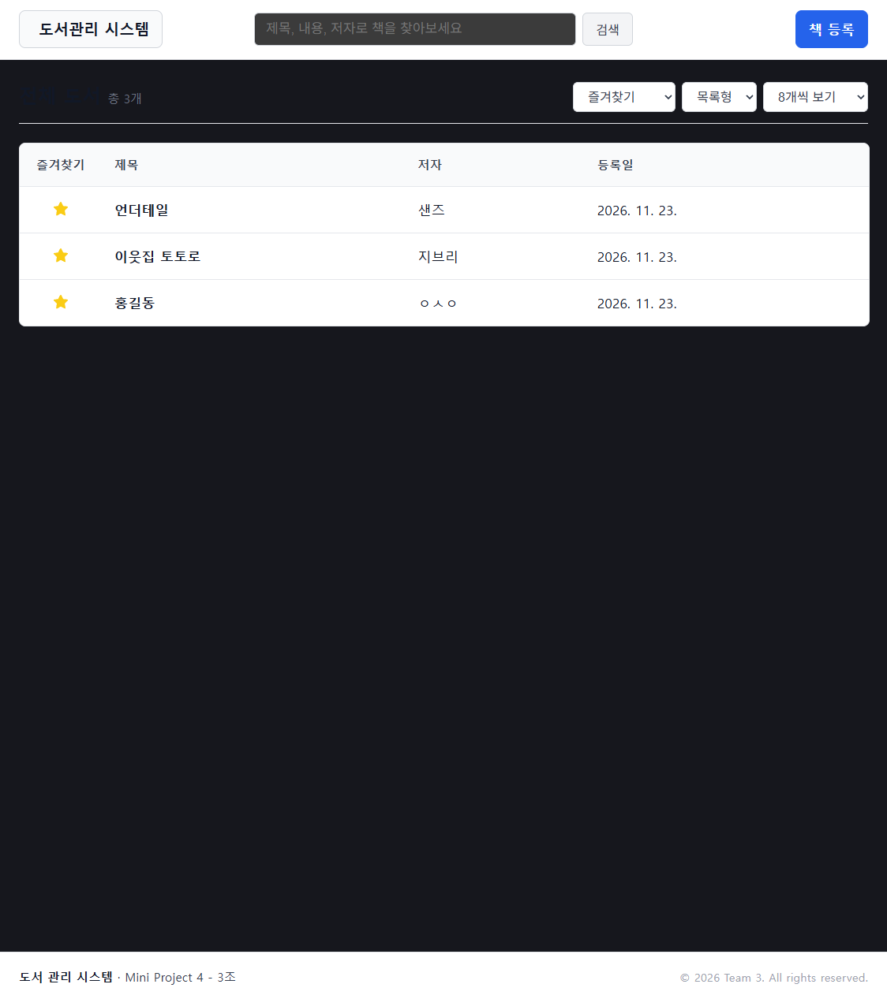
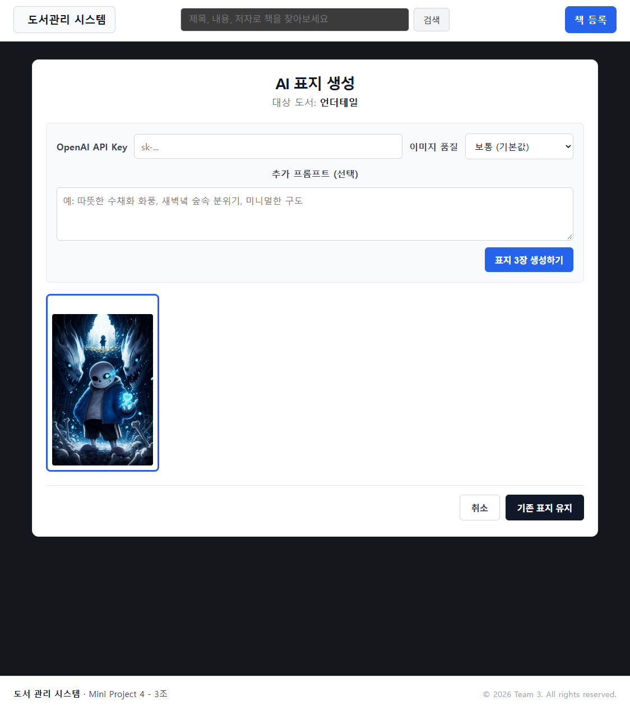
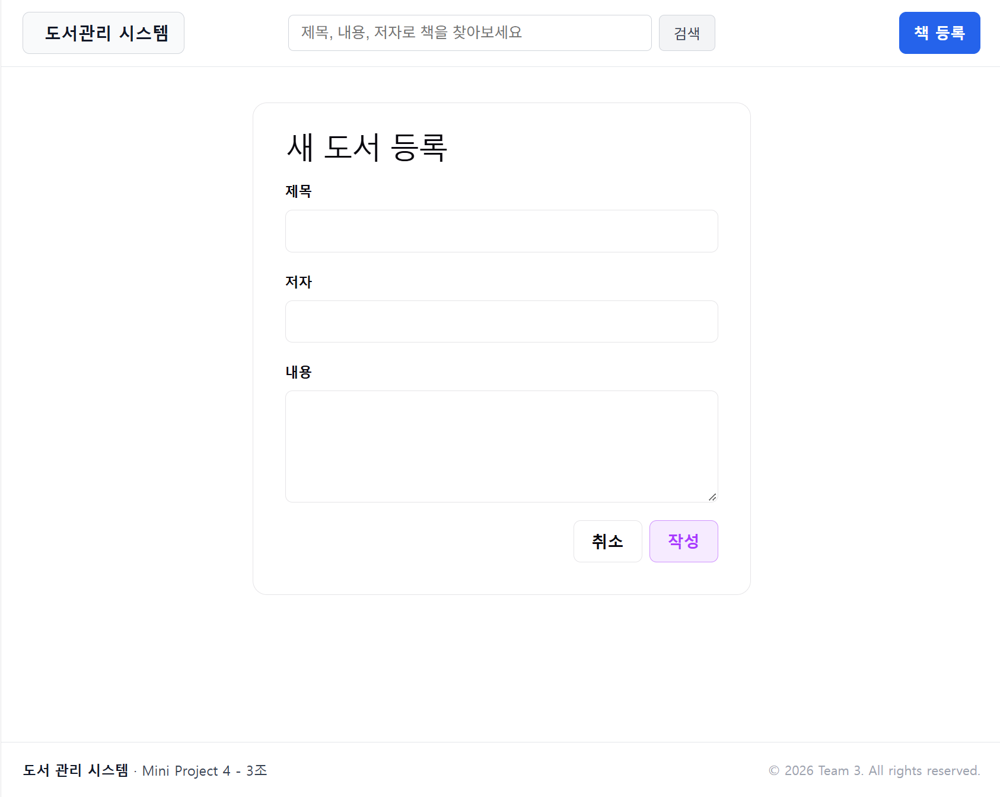

## 양태호 담당 — 2일차 상세 조회 및 삭제

### 실행
`library-manager` 폴더에서 터미널 두 개를 열어 각각 실행합니다.

```powershell
npx.cmd json-server --watch db.json --port 3000
```

```powershell
npm.cmd run dev
```

두 서버를 모두 유지하고 Vite가 출력한 Local 주소를 엽니다.
상세 API 기본 주소는 `http://localhost:3000`이며 `VITE_API_BASE_URL`로 변경할 수 있습니다.
목록 등 다른 페이지의 API 설정과 같은 주소를 사용해야 합니다.

### 상세 API 명세
| 메서드 | 경로 | 기능 | 처리 |
|---|---|---|---|
| GET | /books/:id | 단일 도서 조회 | 제목·저자·본문·표지·등록일·수정일 표시 |
| DELETE | /books/:id | 도서 삭제 | 사용자 확인 후 실행, 성공 시 목록으로 이동하고 완료 안내 |

- GET 요청 중 로딩, 404 시 존재하지 않는 도서 안내, 기타 실패 시 재시도 버튼을 표시합니다.
- URL id 변경 또는 화면 이탈 시 이전 조회를 취소해 오래된 응답 반영을 막습니다.
- 표지가 없거나 이미지 로딩이 실패하면 기본 표지를 표시합니다.
- 수정 버튼은 `/books/:id/edit`로 이동합니다.
- 삭제 취소 시 요청하지 않습니다. 삭제 중 중복 클릭과 모달 닫기를 방지합니다.
- DELETE 실패 시 확인창을 유지하고 오류를 안내합니다. 404는 이미 삭제된 것으로 처리합니다.
- 삭제 후 목록 페이지가 마운트되며 도서 목록을 다시 조회합니다.
- 성공 안내는 닫기 버튼으로 해제합니다.

### QA 범위
실제 조회, 없는 id, 수정 링크, 삭제 취소, 테스트 도서 삭제 및 목록 반영을 확인합니다.
서버 장애·느린 응답 등 미검증 항목은 완료로 표시하지 않습니다.
AI 생성·표지 영구 저장은 3일차 연동 범위로 별도 관리합니다.

### 2026-11-23 검증 결과
- 빌드 및 App.jsx / BookDetailPage.jsx ESLint 통과.
- 실제 도서 상세 조회와 수정 링크 경로 확인.
- QA 전용 도서 생성 → 삭제 취소 → 상세 유지 확인.
- QA 전용 도서 삭제 → 버튼 비활성화 → 목록 복귀 및 삭제 완료 안내 확인.
- 목록 재조회에서 QA 전용 도서 제거 확인.
- 삭제된 id 재접근 시 도서 없음 안내 확인.
- 서버 장애에 따른 조회 재시도·삭제 실패, 모바일 레이아웃은 이번 검증에서 미수행.

### 상세 페이지 오류 처리 추가 QA (2026-11-23)
- 별도 QA 서버에서 실제 상세 페이지 코드를 실행하고 API 오류를 재현했습니다.
- GET /books/1에 HTTP 503 응답: 조회 실패 안내 및 다시 시도 버튼 표시 확인.
- GET 응답 정상 복구 후 같은 화면에서 다시 시도: 오류 안내가 사라지고 실제 도서 정보가 표시됨을 확인.
- DELETE /books/1에 HTTP 503 응답: 삭제 확인창 유지, 오류 안내, 취소·삭제 버튼 재활성화 확인.
- 실패 후 취소: 상세 화면 유지 확인.
- QA 서버가 실제 DELETE 전달을 차단했으며 운영 중인 로컬 DB를 수정하지 않았습니다.
- HTTP 오류에 대한 UI 검증 결과입니다. 연결 끊김·타임아웃·모바일 검증은 별도입니다.
- 두 항목 모두 기존 코드로 통과하여 기능 코드 수정은 하지 않았습니다.

---

## 김병헌 담당 — 공통 레이아웃(Header/Footer), AI 표지 생성 페이지, 목록형 보기

### 사전 준비 (AI 표지 생성)
- AI 표지 생성 화면에서 유효한 OpenAI API Key(`sk-...`)를 직접 입력해야 합니다.
- 입력한 API 키는 `db.json`이나 `localStorage`에 저장하지 않고 요청 시 컴포넌트 상태에서만 사용합니다.

### 구현 및 연동 명세
| 영역 | 대상 파일 | 주요 기능 및 연동 내용 |
|---|---|---|
| 공통 레이아웃 | `Header.jsx`, `Footer.jsx`, `App.css` | 상단 헤더 및 하단 푸터 구성, 콘텐츠 길이가 짧을 때도 푸터가 하단에 고정되도록 Flex 레이아웃 적용 |
| AI 표지 생성 UI | `CoverGeneratePage.jsx`, `CoverGeneratePage.css` | 팀원이 구현한 `coverApi.js`(`generateCover`, `saveCover`)를 호출해 표지 생성·선택·적용 흐름 구현 |
| 목록형 보기 | `BookListPage.jsx`, `BookListHeader.jsx`, `ViewModeSelect.jsx`, `BookList.jsx`, `BookList.css` | `viewMode`(`grid` / `list`) 상태 기반 카드형·목록형 전환 및 텍스트 중심 테이블 뷰 구현 |
| 목록형 즐겨찾기 | `BookList.jsx` | 기존 `FavoriteButton` 컴포넌트와 `useFavorites` 훅(`localStorage` 키 `library_favorites`)을 연동해 카드형/목록형 간 즐겨찾기 상태 동기화 |

### 세부 동작 규칙
- **AI 표지 생성 페이지 (`CoverGeneratePage.jsx`)**
  - 팀원이 작성한 `coverApi.js`의 `generateCover`를 호출하며, 이미지 품질(`low` / `medium` / `high`) 선택과 추가 사용자 프롬프트 입력값을 옵션으로 전달합니다.
  - 기존 표지가 있는 경우 신규 생성 후보와 함께 표시해 비교·선택할 수 있으며, 기존 표지를 유지할 때는 불필요한 `saveCover` 요청을 보내지 않습니다.
  - 수정 화면(`bookId` 존재)에서 표지를 변경하면 `saveCover`로 서버(`PATCH /books/:id`)에 반영하고, 신규 등록 흐름에서는 선택한 이미지를 `location.state`로 돌려보냅니다.
  - API 요청 실패(안전 정책 차단, 응답 누락 등) 시 에러 안내 문구를 화면에 표시하고, 생성·저장 중에는 버튼 중복 클릭을 방지합니다.
- **목록형 보기 및 즐겨찾기 연동 (`BookList.jsx`, `BookListPage.jsx`)**
  - `ViewModeSelect`를 제어 컴포넌트로 변경해 `grid`(카드형)와 `list`(목록형)를 전환합니다.
  - 목록형에서는 표지 이미지 없이 즐겨찾기 버튼, 제목(상세 페이지 이동 링크), 저자, 등록일만 테이블 형태로 표시합니다.
  - 페이지네이션과 `~개씩 보기` 설정은 카드형과 동일하게 유지합니다.
  - 목록형에서 즐겨찾기 버튼을 클릭하면 `useFavorites`의 커스텀 이벤트(`favorites-updated`)를 통해 카드형 및 다른 화면과 상태가 즉시 동기화됩니다.

### QA 범위 및 검증 결과 (2026-11-23)
- Header 및 Footer 렌더링, 콘텐츠가 적은 화면에서 Footer 하단 고정 확인.
- CoverGeneratePage에서 품질 옵션·추가 프롬프트 입력 후 coverApi.js 호출 및 후보 이미지 선택·적용 확인.
- 안전 정책 차단 등 API 오류 발생 시 오류 메시지 표시 확인.
- 카드형(grid) ↔ 목록형(list) 전환 시 현재 페이지 도서 목록 및 페이지네이션 유지 확인.
- 목록형에서 즐겨찾기 토글 후 카드형 전환 및 새로고침 시 상태 유지 확인.

| 목록형 보기 페이지 | AI 표지 생성 페이지 |
|---|---|
|  |  |

---

## 양채훈 담당 — 도서 등록 페이지, 도서 수정 페이지

### 구현 및 연동 명세
| 영역 | 대상 파일 | 주요 기능 및 연동 내용 |
|---|---|---|
| 도서 등록 | `BookCreatePage.jsx` | 제목·저자·내용 입력 후 `POST /books`로 등록, `createdAt`·`updatedAt`을 등록 시각으로 기록, 성공 시 목록(`/`)으로 이동 |
| 도서 수정 | `BookEditPage.jsx` | `GET /books/:id`로 기존 값을 불러와 폼에 채우고 `PATCH /books/:id`로 제목·저자·내용과 `updatedAt` 갱신, 성공 시 상세(`/books/:id`)로 이동 |
| 폼 스타일 | `BookCreatePage.css` | 등록·수정 페이지 공통 폼 레이아웃, 입력칸·버튼·오류 메시지 스타일, 480px 이하 화면 대응 |

### API 명세
| 메서드 | 경로 | 기능 | 처리 |
|---|---|---|---|
| GET | /books?title=&content= | 중복 도서 조회 | 제목과 내용이 모두 같은 도서가 있으면 저장 중단 |
| POST | /books | 도서 등록 | 공백 제거한 입력값과 등록일·수정일 저장 |
| GET | /books/:id | 수정 대상 조회 | 기존 제목·저자·내용을 폼에 표시 |
| PATCH | /books/:id | 도서 수정 | 제목·저자·내용과 수정일만 갱신 |

### 세부 동작 규칙
- **입력값 검사 (등록·수정 공통)**
  - 제목, 저자, 내용은 모두 필수이며, `trim()` 후 빈 값이면 "제목, 저자, 내용을 입력해 주세요."를 표시하고 요청하지 않습니다.
  - 제목은 100자, 저자는 50자로 제한합니다. 입력칸 `maxLength`와 제출 시 길이 검사를 함께 적용합니다.
  - 서버에는 앞뒤 공백을 제거한 값을 저장합니다.
- **중복 도서 방지**
  - 저장 전 `GET /books?title=...&content=...`로 제목과 내용이 모두 같은 도서를 조회하고, 있으면 "이미 등록된 도서입니다."를 표시합니다.
  - 제목만 같거나 내용만 같은 도서는 등록할 수 있습니다.
  - 수정 페이지에서는 자기 자신을 제외하고 비교합니다.
- **수정 페이지 (`BookEditPage.jsx`)**
  - 제목·저자·내용이 불러온 값과 모두 같으면 "변경된 내용이 없습니다."를 표시하고 요청하지 않아, `updatedAt`이 불필요하게 갱신되지 않습니다.
- **오류 안내 및 취소**
  - 서버 요청이 실패하면 "~하지 못했습니다. 서버 연결을 확인해 주세요."를 오류 박스로 표시합니다.
  - 네트워크 오류는 공통 `catch`에서 처리하며, 브라우저 `fetch` 특성상 CORS·DNS 등 원인별 구분은 하지 않습니다.
  - 취소 버튼은 등록 페이지에서 목록으로, 수정 페이지에서 해당 도서 상세로 이동합니다.

### 검증 결과(2026-11-23)
- `BookCreatePage.jsx`, `BookEditPage.jsx` ESLint 통과 및 `vite build` 성공.
- json-server 중복 조회 확인: 제목·내용 모두 일치 시 조회됨, 제목만 일치하거나 일부만 일치 시 조회되지 않음.
- 공백만 입력, 글자 수 초과 시 안내 메시지 표시 확인.
- 중복 도서 등록 시 안내 메시지 표시 및 등록 차단 확인.
- 수정 페이지에서 변경 없이 제출 시 안내 메시지 표시 확인.
- 등록·수정 성공 후 목록·상세 이동 및 취소 버튼 이동 확인.

| 도서 등록 페이지 | 도서 수정 페이지 |
|---|---|
|  |  |

---

## 김연신 담당 — 도서 목록 페이지, 서버 동적 불러오기·페이지네이션, 검색, 정렬

### 구현 및 연동 명세
| 영역 | 대상 파일 | 주요 기능 및 연동 내용 |
|---|---|---|
| 도서 목록 화면 | `BookListPage.jsx`, `BookListPage.css` | 헤더(총 권수·드롭다운) / 카드 그리드 / 페이지네이션 3단 구성, 4열 그리드(반응형) 스타일 |
| 도서 카드 | `BookGrid.jsx`, `BookCard.jsx`, `BookCover.jsx` | 표지·제목·저자 카드, 표지가 없으면 기본 아이콘 표시 |
| 서버 동적 불러오기 | `BookListPage.jsx` | `GET /books?_page&_limit`으로 현재 페이지만 요청, 전체 권수는 `X-Total-Count` 헤더로 계산 |
| 페이지네이션 | `Pagination.jsx`, `PageSizeSelect.jsx`, `BookListHeader.jsx` | 이전 / 페이지 번호 / 다음 버튼, 8·12·16·20개씩 보기 선택 |
| 검색 | `Header.jsx`, `bookApi.js`(`searchBooks`), `BookListPage.jsx`, `App.jsx` | 제목·내용·저자 검색, 검색어를 URL 쿼리(`/?q=`)로 관리, 결과 병합·중복 제거·클라이언트 페이지네이션 |
| 정렬 | `SortSelect.jsx`(`SORT_OPTIONS`), `BookListHeader.jsx`, `BookListPage.jsx` | 최신 등록순 / 최근 수정순 / 제목순, 목록은 서버 정렬·검색 결과는 클라이언트 정렬 |
| 결과 없음 안내 | `BookListPage.jsx` | 표시할 도서가 0권이면 안내 문구 표시 |

### 사용 API 명세
| 메서드 | 경로 | 용도 |
|---|---|---|
| GET | `/books?_page={n}&_limit={n}&_sort={field}&_order={asc\|desc}` | 목록 페이지 단위 조회 + 정렬 |
| GET | `/books?title_like={키워드}` | 제목 검색 |
| GET | `/books?content_like={키워드}` | 내용 검색 |
| GET | `/books?author_like={키워드}` | 저자 검색 |

### 세부 동작 규칙
- **서버 동적 불러오기 (`BookListPage.jsx`)**
  - 처음 화면에 들어오거나 페이지·개수·정렬이 바뀔 때 현재 페이지 분량만 서버에 요청합니다.
  - `AbortController`로 이전 요청을 취소해, 마지막 요청 결과만 반영합니다.
  - 요청 중에는 "불러오는 중...", 실패 시 "에러: 책 요청 실패: {상태코드}"를 표시합니다.
  - 페이지당 개수나 정렬이 바뀌면 1페이지로 이동합니다.
- **페이지네이션 (`Pagination.jsx`)**
  - 전체 권수와 페이지당 개수로 전체 페이지 수를 계산하며, 1페이지 이하이면 표시하지 않습니다.
  - 첫 페이지에서 [이전], 마지막 페이지에서 [다음] 버튼을 비활성화합니다. 페이지 이동 시 화면 맨 위로 스크롤합니다.
- **검색 (`Header.jsx`, `bookApi.js`)**
  - 앞뒤 공백을 제거한 검색어가 2글자 미만이면 입력창에 브라우저 말풍선(`setCustomValidity`)으로 안내합니다. 빈 검색어는 전체 목록으로 이동합니다.
  - 검색어는 `/?q=검색어`로 URL에 저장해 새로고침·뒤로가기 후에도 유지됩니다.
  - `title_like`, `content_like`, `author_like` 요청 3개를 `Promise.all`로 동시에 보내고, 결과를 `Map`으로 합쳐 id 기준 중복을 제거합니다.
  - json-server의 `_like`는 정규식으로 처리되므로 `(`, `+` 등 특수문자를 이스케이프해 서버 오류를 막습니다.
  - URL에서 직접 1글자를 넣어도 검색으로 처리하지 않고 일반 목록을 보여줍니다.
  - 검색 결과는 한 번만 받아 두고, 페이지 이동은 서버 요청 없이 화면에서 잘라 보여줍니다.
  - `BookListRoute`에서 검색어를 `key`로 주어, 새로 검색하면 목록 상태가 초기화되어 1페이지부터 표시됩니다.
- **정렬 (`SortSelect.jsx`, `BookListPage.jsx`)**
  - `SORT_OPTIONS`에 정렬 기준(`field`)과 방향(`order`)을 함께 정의해 목록·검색이 같은 기준을 사용합니다.
    - 최신 등록순 `createdAt desc` / 최근 수정순 `updatedAt desc` / 제목순 `title asc`
  - 일반 목록은 json-server의 `_sort`, `_order`로 서버에서 정렬합니다.
  - 검색 결과는 복사본을 `localeCompare(…, 'ko')`로 정렬한 뒤 페이지를 나눕니다. 정렬을 바꿔도 서버에 다시 요청하지 않습니다.

### QA 범위 및 검증 결과 (2026-11-23)
- [v] 목록 페이지 단위 조회(`_page`, `_limit`) 및 `X-Total-Count`로 전체 권수(24권) 확인.
- [v] 검색: 제목(`달을`), 내용(`기록`), 저자(`정하늘`) 검색 결과 확인, 제목·저자 동시 일치(`하늘`) 시 중복 제거 확인.
- [v] 특수문자 검색어(`(상)`, `C++`) 입력 시 서버 오류 없이 0건 처리 확인.
- [v] 정렬 3종: 일반 목록(서버 정렬)과 검색 결과(클라이언트 정렬) 모두 순서 확인.
- [v] 브라우저 화면 검증(페이지당 개수 변경 시 1페이지 이동, 새 검색 시 1페이지 표시, 2글자 미만 말풍선) 모두 확인.

---

## 김은서 담당 — 도서 즐겨찾기 및 즐겨찾기 필터링
### 구현 및 연동 내역

- **상태 관리(`src/services/useFavorites.js`):** 브라우저 `localStorage`(`library_favorites`)에 즐겨찾기된 도서 ID 배열을 저장하고, 변경 시 `favorites-updated` 이벤트를 통해 화면 간 상태를 실시간으로 동기화합니다.
- **토글 UI(`FavoriteButton.jsx`):** 도서 카드(`BookCard`)와 상세 페이지(`BookDetailPage`) 우측 상단에 즐겨찾기 별 버튼을 연동해 등록·해제를 지원합니다.
- **즐겨찾기 필터링(`SortSelect.jsx`, `BookListPage.jsx`):** 정렬 드롭다운에 `즐겨찾기` 옵션을 추가해 즐겨찾기된 도서만 모아볼 수 있도록 연동했습니다.

### 주요 동작 규칙

- 카드의 별 버튼 클릭 시 `e.stopPropagation()`을 적용해 상세 페이지로 이동하지 않고 상태만 토글됩니다.
- `즐겨찾기` 필터 상태에서 별을 해제하면 새로고침 없이 목록에서 즉시 제외되며, 현재 페이지가 비게 될 경우 이전 유효 페이지로 자동 이동합니다.
- 검색어 입력 상태에서도 `즐겨찾기` 필터가 함께 적용됩니다.

### 검증 결과 (2026-11-23)

- 카드·상세 페이지 즐겨찾기 등록/해제 및 새로고침 후 `localStorage` 유지 확인.
- `즐겨찾기` 필터 적용 시 총 권수 반영, 해제 시 즉시 목록 제외 및 페이지네이션 보정 확인.
- `useFavorites.js`의 `src/services/` 경로 이동 후 전체 `import` 및 빌드· 동작 정상 확인.